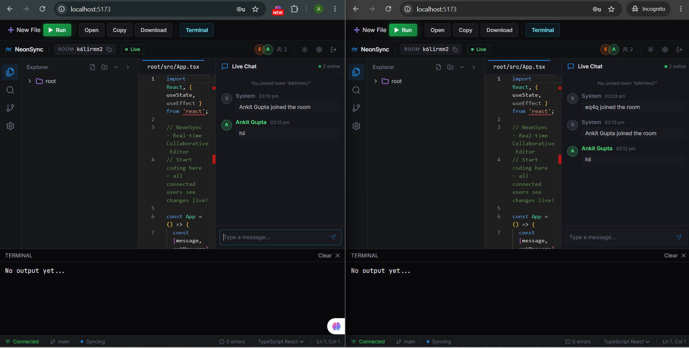

# NeonSync

A collaborative code editor that runs in the browser. You create a room, share the room ID, and everyone in it can open files, edit them and chat, with changes showing up live for the others.

The backend is Spring Boot (REST + WebSocket/STOMP, JWT login, MySQL). The frontend is React + TypeScript with the Monaco editor.

## What works

- Register and log in (JWT)
- Create a room or join one by its ID
- A small file tree with tabs: create, rename, delete and move files
- Live editing, shown per file: if I'm in `utils.ts` and you're in `App.tsx`, my typing only updates `utils.ts` on your screen
- Remote cursors, a list of who's in the room, and a chat panel

## How the live sync works

Every code update goes to `/app/code` as `{ roomId, fileId, code, senderName }`. The server saves the file and broadcasts it to `/topic/room/{roomId}/code`. Each client then updates only the file whose path matches `fileId`.

My first version sent only the code, with no file id, so whatever you were typing replaced the file the other person had open. Adding the file path to the message (and saving code per file in the database) fixed it.

## Run it locally

You need Java 17+, Maven, Node 18+ and MySQL.

Backend:

    cd backend/neonsync
    copy src\main\resources\application.properties.example src\main\resources\application.properties

Fill in your MySQL details and a JWT secret in that file, then:

    mvn spring-boot:run

Frontend (start the backend first, both want port 8080 and Vite will pick another one):

    cd frontend/neon-sync-lab-fixed
    npm install
    npm run dev

To test the sync, log in as one user in a normal window and another user in an incognito window, join the same room, and open different files.

## Not done yet

- File create / rename / delete aren't synced to other users yet
- Someone joining late only gets `App.tsx`, not the other files
- Sync is last-write-wins per file, so two people typing in the same file can overwrite each other. Yjs (a CRDT library) would be the proper fix.

Built by Ankit Gupta.